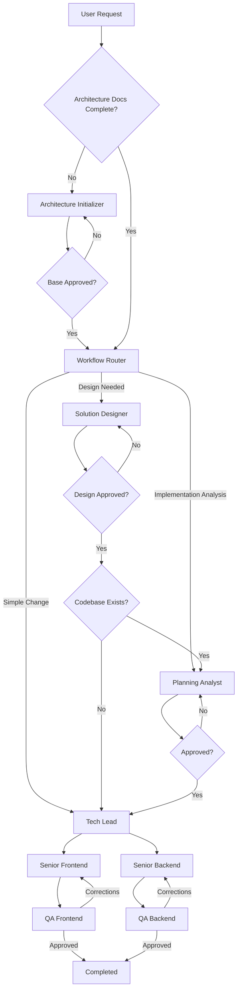

# Delivery Pipeline Skill

## Purpose

Orchestrate the complete software delivery workflow from an initial user request through planning, task creation, implementation, review, and completion.

This skill is the single entry point for project execution and is responsible for workflow orchestration, state persistence, recovery after interruptions, and information handoff between agents.

## Templates

All templates are stored in `.opencode\template` and template variables are inside `.opencode\template\variables.md`

### Variable Resolution

Before dispatching any agent, the orchestrator MUST:
1. Read `variables.md` to load all variable definitions
2. Resolve `[PLAN_FOLDER_LOCATION]` by substituting `<context>` with `pipeline.yaml.name`
3. Resolve all dependent variables (`[DESIGN_FOLDER_LOCATION]`, `[TASKS_FOLDER_LOCATION]`, etc.)
4. Resolve architecture variables (`[ARCHITECTURE_FOLDER_LOCATION]`, `[ARCHITECTURE_ENTRY_FILE]`, `[ARCHITECTURE_INDEX_FILE]`, `[ARCHITECTURE_TEMPLATE_FILE]`, `[DOCS_CATALOG_FILE]`, `[PROJECT_STRUCTURE_FILE]`)
5. Pass the resolved values to the agent as part of the execution context

Example:
- `pipeline.yaml.name = "documentation-analysis"`
- `[PLAN_FOLDER_LOCATION]` resolves to `.opencode/plan/documentation-analysis`
- `[DESIGN_FOLDER_LOCATION]` resolves to `.opencode/plan/documentation-analysis/design-docs`

## Commands

### New Execution

```text
delivery-pipeline:new
```

Starts a new delivery workflow.

Responsibilities:

1. Generate a context name.
2. Create the planning folder structure using the `create-folder-structure` tool. The tool creates `design-docs/`, `planning/`, and `tasks/` subfolders. If the selected workflow does not use all folders, unused ones remain empty — this is expected.
3. Create [PIPELINE_FILE] using [PIPELINE_TEMPLATE_FILE].
4. Check whether the architecture documentation set is complete: `.opencode/architecture/` with `[ARCHITECTURE_ENTRY_FILE]` (`.opencode/architecture/architecture.md`) and `[ARCHITECTURE_INDEX_FILE]`, `[DOCS_CATALOG_FILE]` (`.opencode/docs-catalog.md`), `[PROJECT_STRUCTURE_FILE]` (`.opencode/project-structure.md`), and the INDEX.md `# Architecture` section. If any piece is missing (including when a codebase exists without these docs), execute the [Architecture Initialization Flow](references/execution-phases.md#architecture-initialization-flow) before routing.
5. Invoke the Workflow Router skill.
6. Execute the selected workflow.
7. Persist progress after every agent execution.

### Resume Execution

```text
delivery-pipeline:resume
```

Resumes the last execution from [PIPELINE_FILE].

Responsibilities:

1. Load pipeline state.
2. Identify incomplete steps.
3. Resume execution from the last known state.
4. Avoid re-executing completed work.
5. If the `architecture-initializer` step is `pending` (or `running` without output) and the architecture documentation set is missing or incomplete (no `[ARCHITECTURE_ENTRY_FILE]`, no `[DOCS_CATALOG_FILE]`, no `[PROJECT_STRUCTURE_FILE]`, or empty INDEX.md `# Architecture` section), resume the [Architecture Initialization Flow](references/execution-phases.md#architecture-initialization-flow). Never re-run it when the step is `completed` or when the documentation set is already complete. For legacy pipelines without the step, infer from the files — skip if the set is complete, otherwise run it.

## Pipeline State

Pipeline state is stored in:

```text
[PIPELINE_FILE]
```

The pipeline file is the source of truth for workflow execution.
It must be updated after every agent execution by the orchestrator.

## Responsibilities

### Workflow Orchestration

Responsible for:

* Invoking Architecture Initializer (only when the architecture documentation set is missing or incomplete)
* Invoking Workflow Router
* Invoking Solution Designer
* Invoking Planning Analyst
* Invoking Tech Lead
* Invoking Senior Frontend agents
* Invoking Senior Backend agents
* Invoking QA Frontend
* Invoking QA Backend
* Creating per-task commits (implementation + docs) after QA approval

### State Management

Responsible for:

* Creating pipeline state
* Updating pipeline state
* Tracking execution progress
* Tracking task completion
* Tracking errors
* Tracking concerns
* Maintaining execution history
* Supporting workflow recovery

### Agent Dispatch Rules

**Primary agents** (Architecture Initializer, Planning Analyst, Solution Designer) are defined with `mode: primary` in their agent files. They must be dispatched using their proper agent type name via `task` with `subagent_type` matching the agent name. Do NOT dispatch primary agents as `general` or any other type — this skips their workflow and prevents file creation.

**Subagents** (Senior Frontend, Senior Backend, QA) use `mode: subagent` and are dispatched using their proper agent type name via `task` with `subagent_type` matching the agent name, with their task instructions inline.

**Dispatch stalls/failures:** If a named agent dispatch fails or stalls (e.g., a model-resolution error such as `Model not found: opencode/...`), retry the SAME dispatch up to 3 consecutive attempts. If all 3 attempts fail, ABORT the step and REPORT the error — never fall back to dispatching as `general` or any other agent type to work around a failed dispatch.

### Orchestrator Must Never Do Agent Work

The orchestrator must **never** implement, write, or modify source code directly. Its sole responsibility is dispatching agents, managing state, and passing context.

If an agent:
- Returns an error → re-call the same agent with the error context
- Returns a partial result → re-call to complete the remaining work
- Returns non-standard format → re-call with format requirements
- Asks a question → respond to the agent directly (do not resolve it yourself)
- Times out → verify output dir; if files were created, mark done; otherwise re-call with higher timeout

**Never fix agent output yourself.** If an agent's code has a bug or build error, re-call the agent with the error details. Do not edit the agent's files, run build commands, or patch the code manually.

**Never run validation commands yourself.** Build, lint, and typecheck commands are the responsibility of subagents and QA. The orchestrator only dispatches agents and updates pipeline state.

If the orchestrator needs to make any code change, it must dispatch an agent to do it.

### Information Handoff

The orchestrator must provide agents with all available context whenever possible.

The orchestrator should pass the minimum set of information required for execution.

Agents should not need to locate, search, or aggregate project context on their own whenever the information is already available.

Agents should not need to read:

```text
design-docs/
tasks/
planning/
pipeline.yaml
```

unless their role explicitly requires it.

The orchestrator should consolidate and pass:

* User request
* Pipeline context name
* Selected approach
* Approved planning artifacts
* Design summaries (passed from SD to PA when chained)
* Architecture base summary (passed from the Architecture Initializer to downstream agents)
* Task summaries
* Acceptance criteria
* Relevant dependencies
* Previous execution results

## Workflow



## Execution Phases

The detailed phase execution — Architecture Initialization Flow, Routing, Solution Designer Flow, Planning Flow, Tech Lead Flow, Parallel Execution, QA, Corrections, Task Commit, and Completion — is documented in [references/execution-phases.md](references/execution-phases.md).

## Parallelization Rules

See [references/parallelization-rules.md](references/parallelization-rules.md)

## Failure Recovery

See [references/failure-recovery.md](references/failure-recovery.md)

## Pipeline Updates

After EVERY agent dispatch completes, BEFORE dispatching the next agent, update `pipeline.yaml` with:

* The completed step's status (completed / failed / errors)
* errors and concerns returned by the agent
* updated_at timestamp

This is mandatory — missed updates cause recovery failures and loss of execution history.

After every agent execution update:

* status
* notes
* updated_at
* errors
* concerns

and append a history record.

Implementation task status must also be updated, including the commit SHAs (`feat_commit`, `docs_commit`) created for each finalized task.

Examples:

[ ] TASK-01 Create User Endpoint
[X] TASK-02 Create User Screen

Errors and concerns examples:

```
errors:
  - "Build failed (TS error: info.event.revert() possibly undefined)"
  - "Subagent created files outside task scope (test helper script)"
concerns:
  - "Shell blocked npx tsc — subagent used pnpm build workdir instead"
  - "Subagent could not verify lint (no lint script configured)"
```

### Pipeline Completion

When all steps are completed (all tasks approved by QA), follow the [Execution Phases — Completion](references/execution-phases.md#completion) procedure.

## References

- [Standard Agent Response Format](references/agent-response-format.md) — includes Validation Gate and Step Limit guidelines
- [Task Tracking](references/task-tracking.md)
- [Parallelization Rules](references/parallelization-rules.md)
- [Failure Recovery](references/failure-recovery.md)
- [Execution Phases](references/execution-phases.md)
- [Constraints](references/constraints.md)

## Constraints

See [references/constraints.md](references/constraints.md) for the full constraint list.